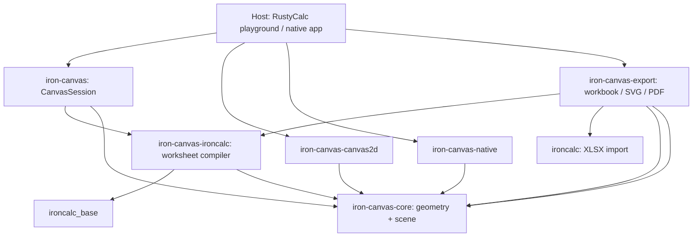

<!-- last-verified-against: M4 completion (2026-10-06) -->
<!-- working-tree-verified: 2026-10-06 -->
<!-- covers: iron-canvas/crates/ iron-canvas/Cargo.toml -->

# iron-canvas architecture

`iron-canvas` renders spreadsheets read-only from `ironcalc_base::UserModel`.
The worksheet is lowered once into an owned, backend-independent **resolved
grid scene**; every backend draws that scene, and the session publishes pixels
and query metadata together. There is no legacy model-trait adapter and no
second renderer: M4 deleted them.

The crate keeps a strict split:

- **core** owns generic geometry, text layout, paint primitives, the scene
  contract, and grid/pane geometry. It has no IronCalc or browser types.
- **iron-canvas-ironcalc** owns worksheet compilation and spreadsheet semantics
  (styles, conditional formatting, borders, links, merges, auto-fit).
- **iron-canvas** owns the render session: request, reuse, frame publication,
  host queries, and overlays.
- **iron-canvas-export** owns SVG/PDF backends plus workbook loading, range
  selection, and export orchestration; it delegates worksheet compilation to
  `iron-canvas-ironcalc`.
- **rendering backends** own rasterization or document painting, not workbook
  semantics.

## Crates and dependency direction



| Crate | Owns | Must not own |
| --- | --- | --- |
| `iron-canvas-core` | Coordinates, bounds, canvas metrics, axis sampling, pane geometry and fragments, hit/resize geometry, text layout, resolved paint primitives and scene execution, retained-pixel fingerprints and damage bands, grid theme defaults | `UserModel`, CF enums, workbook themes, formula references, browser or Cairo calls |
| `iron-canvas-ironcalc` | Direct immutable IronCalc reads, worksheet preparation, style/CF/border/text lowering, merge and link semantics, the CF glyph catalogue, auto-fit measurement | Workbook writes, backends, host event loop |
| `iron-canvas` | `CanvasSession` state and invalidation, request/frame planning, prepare/stage/commit coordination, committed-frame queries and host intents, spreadsheet overlay composition | Formula evaluation, duplicate engine getters, backend drawing |
| `iron-canvas-canvas2d` | Browser `<canvas>` surfaces, the Canvas2D painter, text metrics and memo, the CSS-var theme bridge, the scene backend | IronCalc, workbook scheduling |
| `iron-canvas-native` | Cairo/Pango metrics and raster primitives, staged image surfaces | Window ownership, workbook access |
| `iron-canvas-export` | SVG and PDF painters and their scene backends, font resources, document assembly, XLSX loading, sheet/range selection, export orchestration | A separate worksheet renderer or CF resolver |

Arrows mean compile-time dependencies. `iron-canvas` is generic over the
backend contract and does not depend on any concrete backend crate. No crate
depends on `iron-canvas` except the host.

## Core: generic grid and drawing

### Geometry

- `geometry::{CanvasSize, CanvasMetrics, CanvasMetricError}` — logical size and
  validated size/DPR pair. `CanvasMetrics` is the only checked constructor.
- `geometry::pixel_rect::PixelRect`, `geometry::prim::{Point, Line, Span, Axis,
  Side, RectCorner}` — pixel- and axis-space primitives.
- `geometry::path` — painter path commands.
- `geometry::constants` — generic drawing constants shared by backends
  (`STANDARD_BORDER_WIDTH`, `DASHED_RECT_PATTERN`). Spreadsheet bounds and row
  or column defaults live in the compiler or the host, not here.

### Scene geometry

`scene_geometry` is model-independent:

- `CellCoord`, `GridRange` — 1-based cell coordinates and ranges.
- `sample_axis` / `sample_bands` / `AxisBand` — bounded axis sampling. Frozen
  bands are sampled first, then the scrolling band, both clamped to the
  viewport; `AxisBand::frozen` marks which is which.
- `GridGeometry` — the committed grid: `bounds`, `origin` (header offset),
  row/column bands, and the frozen×scroll `panes`. It answers:
  - `hit_test(point) -> GridHit` (`Cell`/`RowHeader`/`ColumnHeader`/`Corner`),
  - `fragments(range) -> Vec<RangeFragment>` (per-pane clipped rectangles with
    true-edge flags),
  - `cell_rect(row, col)`, `scroll_pane_rect()`, `autofill_handle(range)`,
    `resize_target(point, tolerance) -> GridResize`.

### Paint contract

- `painter::{Painter, TextMetrics}`, plus `PaintColor`, `StrokeStyle`,
  `TextAlign`, `TextBaseline`, `LineCap`, `LineJoin`. Backends implement both
  traits; nothing above them draws.
- `scene::{GridScene, SceneBuilder, Primitive, RenderBackend}`. A `GridScene`
  is a clip plus ordered passes of `Primitive` values (fills, gradients, paths,
  circles, lines, text, explicit clips). `SceneBuilder` interns color/font
  strings and owns the buffer; `GridScene::paint` executes the scene.
- `scene::retained` — `RenderStrategy` (`Fresh`/`Reuse`/`Damage`/`Blit`),
  `SceneUpdate`, `SceneFingerprint` (32-logical-pixel damage bands), and
  `translated_overlap_matches` for verified scroll blits.
- `shape::place` — generic placement and polygon emission used by the CF
  compiler (arrows, stars, glyph geometry).
- `text_layout` — generic wrapping and placement: `layout_text_into`,
  `layout_text_lines_into`, `TextLayoutOptions`, `TextLine`,
  `TextVerticalAlign`, `CELL_PADDING`, `LINE_HEIGHT_FACTOR`, `TEXT_V_INSET_PX`.
- `theme::{CanvasTheme, ThemeVariables, FORMULA_REF_COLORS, FORMULA_REF_TINTS}`
  — grid paint defaults. The host derives `CanvasTheme` from CSS variables.

### RenderBackend

Every backend implements `scene::RenderBackend`:

```rust,ignore
type StagedFrame;
type Error;
fn metrics(&self) -> &dyn TextMetrics;
fn stage_frame(&mut self, scene: &GridScene) -> Result<Self::StagedFrame, Self::Error>;
fn commit_frame(&mut self, staged: Self::StagedFrame) -> Result<(), Self::Error>;

// Optional retained hooks:
fn invalidate_metrics(&mut self) {}
fn retained_scale(&self) -> Option<f64> { None }
fn supports_partial_updates(&self) -> bool { false }
fn stage_update(&mut self, scene: &GridScene, update: &SceneUpdate)
    -> Result<Self::StagedFrame, Self::Error> { self.stage_frame(scene) }
```

`commit_frame` publishes; a failed stage or commit must leave the previous
frame intact.

## IronCalc compiler

`WorksheetCompiler::prepare(workbook, sheet, viewport, metrics, theme)` reads a
borrowed `UserModel` and returns an owned `PreparedWorksheet`:

```rust,ignore
pub struct PreparedWorksheet {
    pub scene: GridScene,
    pub cells: Rc<[CellPlacement]>,
    pub geometry: Option<Rc<GridGeometry>>,
    pub merges: Rc<[MergedCell]>,
    pub links: Rc<[CellLinkView]>,
    pub extended_style_reads: usize,
}
```

- `WorksheetViewport { first_cell, width, height }` selects the visible window.
- `prepare_reusing_geometry` resamples dimensions but reuses a previous
  `GridGeometry` when `bounds`, `origin`, and bands are equal, so a revision
  change need not rebuild equal geometry.
- Preparation is bounded and cached per attempt: a preparation-local record
  serves ordinary cells, offscreen merge anchors, and active-cell restoration;
  each distinct needed cell is read once (`get_extended_cell_style`).
- Pass order is fixed: background, CF graphics, grid borders, explicit borders,
  text, then merge composition. `CellReadOperation` and `WorksheetCompileError`
  report structured preparation failures (sheet, cell, operation, engine
  message).
- `autofit::{fit_width, fit_height, FIT_PADDING, FIT_SCAN_CAP, AutoFitError}`
  measure the widest formatted value / tallest wrapped block over an explicit
  used-range span with the backend's `TextMetrics`, using the same font-CSS
  rule as the text pass so measured equals painted. The span is capped at
  20,000 cells; an empty span is `Ok(None)`, a failed read is `Err`.

## Rendering session

`CanvasSession<B: RenderBackend>` is the single publication boundary.

### Frame lifecycle (`render`)

1. **Request** carries sheet, `RevisionToken { workbook_id, revision }`,
   viewport, `CanvasTheme`, and `OverlayState`. `workbook_id` changes on
   workbook replacement even if the revision restarts at zero.
2. **Reuse** — content is reused without engine reads when the sheet,
   `workbook_id`, theme, revision, and viewport match. Overlay-only changes
   reuse prepared content and recompose overlays; a revision change recompiles
   all visible content (CF can depend on offscreen cells).
3. **Prepare** — `WorksheetCompiler` produces the candidate worksheet.
4. **Compose overlays** onto the candidate (`OverlayState`).
5. **Plan the update** — with a partial-update backend, an unchanged frame is
   `Reuse`, changed 32-pixel bands are `Damage`, and a verified vertical scroll
   with integral device-pixel movement and identical translated paint is
   `Blit`; otherwise `Fresh`. Merges force `Fresh`.
6. **Stage** on the backend (`stage_update`), then **commit**. Only then are
   pixels, query geometry, base content, and fingerprints published together.
   Any preparation/stage/commit error keeps the previous frame and cache truth.
7. `RenderOutcome { sequence, sheet, revision, cell_count,
   extended_style_reads, reused_geometry, strategy }` reports the frame.

`render_fresh` bypasses reuse for reference comparisons.
`CanvasSession::invalidate` (and `backend_mut`) clears backend metric caches
and forces the next render to prepare; call it after fonts change. Target size
and scale are fixed per backend instance.

### Retained rendering

Core hashes every resolved primitive and its effective clip into 32-pixel
bands in one traversal. A backend that opts into partial updates
(`supports_partial_updates`) receives `SceneUpdate` and rounds repair clips
outward to device pixels, clearing their union before repainting intersecting
commands. A `Blit` copies a verified interior overlap and repaints exposed
strips. Backends without partial updates receive `Fresh` only.

### Queries and host intents

Committed-frame queries read only published data:

`hit_test`, `display_cell_at`, `visible_fragments`, `link_at`,
`pointer_intent(Point, PointerAction) -> HostIntent`,
`resize_intent(Point, pixels) -> HostIntent`, `resize_target`,
`cell_rect`, `scroll_pane_rect`, `scroll_origin`, `scroll_to_show(&UserModel,
row, col)`, `autofill_handle`/`autofill_handle_rect`, `fit_column_width`,
`fit_row_height`, `committed_viewport`, `committed_frame`.

`HostIntent` (`Select`, `ActivateLink`, `ResizeRow`, `ResizeColumn`) is a
request; only the host applies writes.

## Overlays

`OverlayState` carries host decoration that is composed onto the candidate
scene and therefore shares the frame's commit:

```rust,ignore
pub struct OverlayState {
    pub selection: Vec<GridRange>,
    pub active_cell: Option<CellCoord>,
    pub clipboard: Option<GridRange>,
    pub formula_references: Vec<FormulaOverlay>, // { sheet, range, color_index }
}
```

Selection fill and outline are edge-aware per fragment. Active-cell
restoration replays prepared content under fragment clips (no engine reads), so
CF and merged content reappear under the selection. Header highlights stay in
their strips. An empty `OverlayState` gives a content-only export.

## Backends

### Canvas2D (`iron-canvas-canvas2d`)

`Canvas2dSceneBackend` owns a detached staging canvas, implements
`RenderBackend` (retained scale, partial updates, `stage_update`), and recycles
its staging surface only after successful presentation. `CanvasPainter` draws
primitives; text metrics are memoized (`measure_cache`); `theme_from_element`
reads the CSS-var palette into a `CanvasTheme`. Fixed size and scale per
instance.

### Native (`iron-canvas-native`)

`NativeSceneBackend` rasterizes with Cairo/Pango into staged image surfaces;
the host owns the window and presentation. Native builds need Cairo and Pango
headers plus `pkg-config` (for example `libcairo2-dev`, `libpango1.0-dev`).
The crate is empty on `wasm32`. Native reuse renders unchanged frames but
partial Cairo repaint stays disabled (a text-edge mismatch in pixel tests);
its Pango width cache is bounded and clears on `invalidate_metrics`.

### SVG and PDF (`iron-canvas-export`)

`SvgSceneBackend` and `PdfSceneBackend` render complete documents from the
same scene (`svg::SvgPainter`, `pdf::PdfPainter`, `pdf::PdfDocument`).
`common/` holds shared color, escaping, and metrics helpers. PDF keeps the
font and opaque-color limits; the scene backends do not read the workbook.
`workbook::export_xlsx` loads the workbook, resolves the sheet and cell range,
uses `WorksheetCompiler` to prepare a scene, then writes it through the
selected scene backend.

## Host integration

The RustyCalc playground (`../RustyCalc-canvas-next`) is the reference host.
It owns a session behind `SceneHandle` and builds each frame with
`request_for(sheet, first_cell, size, theme, overlays, revision)` from the
model's selected view, the canvas size, the CSS theme, and the derived overlay
state. Input, hover, resize, auto-fit, and link activation all read the
committed frame through the session's query surface.

## History

The migration is recorded milestone by milestone; each review states its
validation and limits.

- M0 baseline — [`docs/m0-baseline.md`](docs/m0-baseline.md).
- M1 scene path — [review](docs/reviews/2026-10-04-m1-grid-core.md).
- M2 worksheet composition — [review](docs/reviews/2026-10-05-m2-worksheet-composition.md).
- M3 measured reuse — [review and measurements](docs/reviews/2026-10-05-m3-measured-optimizations.md).
- M4 replace the playground integration and delete the old path —
  [migration map](docs/reviews/2026-10-05-m4-migration-map.md). M4 deleted the
  legacy `CanvasModel`/`Orchestrator` renderer, the `iron-canvas-web` wasm
  facade, the IronCalc adapter/converters, the one-shot export path, and the
  `iron-canvas-recorder` crate; core builds with no features and exposes no
  legacy symbols.

## Source map

| Path | Contents |
| --- | --- |
| `iron-canvas-core/src/geometry/` | `extent` (size/metrics), `pixel_rect`, `prim`, `path`, `constants` |
| `iron-canvas-core/src/scene_geometry.rs`, `scene_geometry/` | axis sampling, `GridGeometry`, hits, fragments, pane math |
| `iron-canvas-core/src/scene.rs`, `scene/` | `GridScene`, `SceneBuilder`, `Primitive`, `RenderBackend`, retained fingerprints |
| `iron-canvas-core/src/painter/`, `text_layout.rs`, `theme.rs`, `shape/` | paint contract, wrapping, palette, shape placement |
| `iron-canvas-ironcalc/src/compiler.rs`, `compiler/` | worksheet preparation, style/CF/border/text/merge lowering, glyph catalogue |
| `iron-canvas-ironcalc/src/autofit.rs` | auto-fit measurement |
| `iron-canvas/src/lib.rs` | `CanvasSession`, request/outcome/error, frame publication |
| `iron-canvas/src/interaction.rs` | committed queries and `HostIntent` |
| `iron-canvas/src/overlays.rs` | `OverlayState` composition |
| `iron-canvas/src/retained.rs` | scroll-blit planning |
| `iron-canvas/examples/` | host tools: `linux_xlsx_viewer` (GTK4) and the `export_workbook` Clap CLI |
| `iron-canvas-canvas2d/src/` | `CanvasPainter`, `Canvas2dSceneBackend`, metric memo, theme bridge |
| `iron-canvas-native/src/` | Cairo/Pango painter and `NativeSceneBackend` |
| `iron-canvas-export/src/{svg,pdf,common}/` | painters, scene backends, document assembly |
| `iron-canvas-export/src/workbook.rs` | workbook-to-file export API (`export_xlsx`) |

## Verification

- `cargo test --workspace --locked` — unit + integration tests.
- `cargo check -p iron-canvas-core --locked` and
  `cargo check --workspace --target wasm32-unknown-unknown --locked`.
- `cargo clippy --workspace --all-targets --locked -- -D warnings`.
- `cargo fmt --all -- --check`.
- Browser pixel proof: `cargo test -p iron-canvas --target
  wasm32-unknown-unknown --test cf_fixture_canvas2d` (needs a
  `wasm-bindgen-test-runner` whose schema matches the workspace's pinned
  `wasm-bindgen` version, and ChromeDriver).
