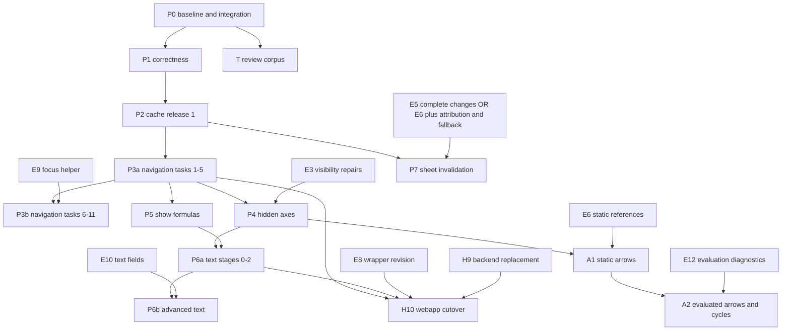

# iron-canvas roadmap

Date: 2026-10-12. Reviewed and corrected: 2026-10-13 at `09ebb6e`.
Scope: sequencing of the in-flight designs, plans, reviews, and tooling for the
iron-canvas workspace and its engine fork.
Status: sequencing proposal, with P1 implementation progress recorded below.

P1 progress reviewed on 2026-10-15: branch `crate-review` implements findings
1–14, including the additional branch review fixes. Findings 15–18 remain
open. See [the branch review](reviews/2026-10-15-crate-review-base.md) for
evidence and [the PR draft](../PR-draft-fix-base.md) for the proposed change set.

This document owns the order. Each design or plan owns its own detail. When the
two disagree on order, this document wins. When they disagree on content, the
design or plan wins, and this document gets a correction.

## 1. How to read this

- An item has an id, an owner crate or repo, a gate, and a blocker list.
- The engine is the sibling repository `CoalUnicorn/IronCalc`, pinned in
  `Cargo.toml:12-13`. Engine items land there first, then the pin moves.
  Decision `D-1`: engine work lands **in the fork**. Upstream pull requests are
  optional and come later, one item at a time.
- P0, P1, P2, and P3a form the initial sequence. Later items use the explicit
  blockers below. E, T, A, and independent host checks can run in parallel.
- Do not start an item before its blockers are closed. Do not batch two
  breaking API changes in one change set (section 5).

## 2. Input inventory

| Document | Kind | Status as written | Verdict |
| --- | --- | --- | --- |
| `docs/designs/2026-10-12-per-sheet-worksheet-cache.md` | design | draft, no implementation | Adopt. Release 1 lands in phase 2, phase 2 lands in phase 7 |
| `docs/designs/2026-10-10-formula-dependency-arrows.md` | design | draft, no implementation | Adopt. Static query is E6; renderer/host delivery is track A |
| `docs/designs/2026-10-10-text-rendering.md` | design | draft, no implementation | Adopt. Rotation, shrink/indent, and rich text wait on E10; host-label sharing does not |
| `docs/plans/2026-10-10-grid-navigation-and-selection.md` | plan | proposed | Adopt. It replaces the keyboard design below |
| `docs/plans/2026-10-09-hidden-rows-columns.md` | plan | proposed | Adopt after the engine repairs (E3) |
| `docs/plans/2026-10-09-show-formulas.md` | plan | proposed | Adopt. No engine change needed |
| `docs/plans/2026-10-09-ironcalc-update-and-canvas-lessons.md` | plan | applied dependency bump | Done. Its five follow-ups move to the backlog (section 9) |
| `docs/plans/2026-10-11-ironcalc-exposed-internals.md` | gap analysis | read-only | Adopt as the accessor request list (E1, E2, E4); raw tables are already public |
| `docs/plans/2026-10-10-webapp-iron-canvas-port.md` | plan | proposed | Rendering work waits on P3a/S6, H9, E8, and P6a spill; engine/package wiring can precede cutover |
| `docs/plans/2026-10-12-dotnet-web-and-native-workbook-viewer.md` | plan | phases 1 to 4 landed; WPF vetoed (`D-5`) | Adopt phases 6 and 7 in phase 8. The desktop head moves to a later Avalonia example |
| `docs/plans/2026-10-09-workbook-render-review.md` | plan | tool migrated to branch `ux-review-tool` | Live as tooling track T. Engine revision already re-pinned (`D-4`) |
| `docs/designs/2026-09-26-canvas-keyboard-navigation.md` | design | research draft | Superseded. It targets the deleted orchestrator and `iron-canvas-web` (`docs/reviews/2026-10-10-navigation-design-after-canvas-split.md` finding 1) |
| `docs/research/2026-09-26-extended-grid-navigation-and-crdt.md` | research | no implementation | Reference only. No CRDT dependency |
| `docs/reviews/2026-10-04-m1..2026-10-05-m4` | reviews | landed | Historical |
| `docs/reviews/2026-10-10-navigation-design-after-canvas-split.md` | review | review only | Adopt its recommendations into the navigation plan |
| `CRATE_REVIEW.md` | findings | 18 findings; tracked on `crate-review` | Findings 1–14 fixed on that branch; 15–18 remain in P1 |

## 3. Baseline facts

The baseline below records the 2026-10-13 `dot-net` snapshot.
The 2026-10-15 P1 review used `crate-review` at `a0157b0`, plus its review fixes,
against local `main` at `6cbaf30`. It does not include the .NET branch.
The engine pin remains `7e6ae21c0f163cacf56b9d47acf777454bfaa243`.
Local refs only; no remote fetch.
Database counts below are historical and were not refreshed.

- Branch `dot-net`, HEAD `09ebb6e` (the roadmap pointer in `ARCHITECTURE.md`).
  `dot-net` is `main` (`26f9591`) plus six commits.
- The pinned engine revision is
  `7e6ae21c0f163cacf56b9d47acf777454bfaa243` in `Cargo.toml:12-13` and
  `Cargo.lock:859`, `:875`.
- The bump plan (2026-10-09) is applied. All five upstream pull requests it
  lists are already inside the pin.
- Workspace members: `crates/*`, `bindings/wasm`, `bindings/dotnet`,
  `examples/react/wasm` (`Cargo.toml:2`).
- Landed: the M4 architecture, six crates, three hosts (GTK4 example, React,
  .NET web and native transport), `bindings/dotnet` phases 1 to 4.
- Not landed: every feature design in section 2, and the navigation modules.
- `docs/`, `CRATE_REVIEW.md`, `SCRATCH_PAD.md`, `tools/`, and two session
  artifacts are untracked (`git status`).
- `tools/workbook-review/` in this checkout contains generated output, not the
  tool manifest/source. The source is on local branch `ux-review-tool`
  (`247d33c`), whose manifest pins the current `7e6ae21c` engine. Do not use a
  machine-specific old worktree as the source of truth.
- The previous inspection reported 262 workbooks, 110 snapshots, 200 captures,
  and 18 findings in `.workbook-review/suite.sqlite`. These counts and snapshot
  compatibility are unverified in this review. T2 must inspect ready sets before
  any replay claim. `.gitignore` covers the artifact root.

### 3.1 Branch landing order

This table records the 2026-10-13 landing plan. The four correctness branches
below are now integrated into `crate-review`; their refs have not been deleted.
The remaining rows still need their own integration review.

`main` (`26f9591`) was the integration line. `dot-net` (`09ebb6e`) is that `main`
plus six commits. Land in this order.

| Branch | Content | Base | Action |
| --- | --- | --- | --- |
| `fix/pixel-rect-intersection-overflow` | Finding 1, one commit | `b898b43`, an ancestor of `main` | Review and land in P1 |
| `fix/retained-coverage-offscreen-overflow` | Finding 2, one commit | `b898b43` | Review and land in P1 |
| `fix/text-layout-preserve-whitespace` | Finding 3, one commit | `b898b43` | Review and land in P1 |
| `origin/fix/text-layout-fractional-center` | Finding 6, one commit | Not merged | Fetch, review, land in P1 |
| `ux-review-tool` | Tool plus export/host integration, 22 commits; current engine pin | `184360b`, one commit behind `main` and seven behind `dot-net` | Review integration diff, land onto the chosen line, then track T |
| `testing-xlsx` | 18 commits of workbook-review capture work | `36ad4a0`, an **ancestor of `ux-review-tool`** | Contained in `ux-review-tool`. Delete with it |
| `bump-ironcalc`, `tables-demo` | Both point at `b210cf8` (`astra(tables) init`), which is in no other branch and in no merged line | Orphaned | Decide: keep, or record and drop |
| `astra-review`, `ci-testing-etc`, `formula-refs-ops`, `txt` | Merged into `main` | — | Delete |

The fix branches share an ancestor with `main`; that does not prove conflict-free
integration or passing gates. Review each diff and test the integrated result.
The tool branch is 22 commits ahead and one behind `main` (seven behind
`dot-net`). Its changes include renderer export/host hooks, not only tool files.
Review those integration points before choosing merge or rebase. Land the
current six `dot-net` commits on the chosen integration line before treating
the .NET work as part of its baseline.

## 4. Dependency map



P4 and P5 follow P3a's overlay migration. Order their breaking API change sets
separately; neither waits for E9 or full P3b. P6a follows both. P7 uses either
proved E5 reports or E6 with complete attribution and conservative fallbacks;
E6 alone is not a renderer-invalidation contract. T runs beside P1, supplies
regression cases, and must establish T4 before profile-gated optimization.
H7 Windows smoke and H9 backend replacement do not wait for P6/P7.

## 5. Ordering rules

| Rule | Reason |
| --- | --- |
| Closure first. Fix `pixel_rect` and retained coverage panics before any feature touches that code | Findings 1 and 2 of `CRATE_REVIEW.md` are panics under overflow checks |
| One breaking API change per change set, ordered by blast radius: navigation, then hidden rows, then show formulas | Navigation changes `OverlayState` and adds `RenderError::InvalidOverlay`. Hidden rows change the `resize_intent` signature. Show formulas changes request identity and compiler signatures |
| Prioritize E3 and the chosen E5/E6 route, then E8/E9 by consumer need | E4 is accessor/importer work, not a prerequisite for engine-owned reference queries |
| One engine pin move per phase, never inside a feature branch | The bump plan proves cross-pin binary incompatibility, so saved snapshots and hosts move together |
| Extend `cf_fixture_canvas2d` for retained/Fresh raster proof | Add host interaction tests separately for focus, IME, input order, and presentation; pixel equality does not prove those contracts |
| Additive changes may batch; group one coherent API migration per change set | `WorksheetCache` and `render_cached` are additive. Public request/outcome fields and new exhaustive enum variants can break consumers |
| A phase closes only when its gate output is recorded | Section 10 lists the commands |
| Engine work lands in the fork (`D-1`). Keep one concern per commit and keep every patch upstream-ready | The fork is the delivery path for E3, E6, E8, E9, E10, and E12. A rebase path to upstream stays open, and a pin move stays a single batch |
| Never mix an engine pin move with a feature change set | The pin move changes behavior underneath the renderer. The bump plan proves saved snapshots do not survive it |

## 6. Phases

### P0 Land and clean

| Id | Item | Owner | Gate |
| --- | --- | --- | --- |
| D1 | Track `docs/` and `CRATE_REVIEW.md` in git on a new branch (`D-6`, owner). Decide the fate of `SCRATCH_PAD.md` and the two session artifacts (move to `notes/`, which `.gitignore:4` covers, or delete) | repo | `git status` shows no untracked plan or review |
| D2 | Inventory and remove only confirmed disposable build output `tools/workbook-review/target` and `tools/workbook-review/ui/{dist,node_modules}` from the working tree. The source is on branch `ux-review-tool` (T1, `D-4`) | repo | `git status` clean under `tools/` |
| D3 | Verify the browser gate runs: `wasm-bindgen-test-runner` matching the workspace pin plus ChromeDriver | repo | `cargo test -p iron-canvas --target wasm32-unknown-unknown --test cf_fixture_canvas2d --locked` passes; record the output |
| D4 | Record the current pin, lock entries, and the gate result as the P0 baseline | repo | Baseline block appended to this document or to a review |

### P1 Correctness

Source: `CRATE_REVIEW.md`, 18 findings. Close each finding here. Reproduce each against the integrated baseline before assigning a fix. Some
export fixes require a font/encoding policy and may not be small. Record closure
or an explicit supported limitation; passing workspace tests alone is not closure.

| Id | Findings | Owner | Progress on `crate-review`, 2026-10-15 |
| --- | --- | --- | --- |
| C1a | Findings 1, 2, 3, 6 | `iron-canvas-core` | Integrated and reviewed. Tests pass. Branch cleanup remains |
| C1b | Findings 4, 5 (hidden final edge, autofill handle at a hidden cell) | `iron-canvas-core` | Fixed, including exact viewport and frozen boundaries. Regressions pass |
| I1 | 7, 8, 9, 10, 11 (auto-fit, theme color, icon layout) | `iron-canvas-ironcalc` | Fixed. Tiny-placement overflow also repaired. Regressions pass |
| B1 | 13 (canvas2d composite on commit), 12 (resize target versus intent) | `iron-canvas-canvas2d`, `iron-canvas` | Fixed. Native intent tests and seven browser tests pass |
| X1 | 14 to 18 (export evaluation, PDF encoding, SVG arc, bold and italic, whitespace) | `iron-canvas-export` | 14 fixed and checked with three XLSX cache fixtures in SVG and PDF. 15–18 open |

P1 is partial. The 2026-10-15 branch review records passing workspace tests,
clippy, formatting, the Wasm check, export feature tests, and browser pixels.
This gate evidence covers findings 1–14. P2 still waits for P1 closure.

Findings 4, 5, and 12 touch semantics that P4 also touches. Fix them here so P4
builds on fixed behavior.

Gate: workspace tests, clippy, fmt, the browser gate. Export findings need an
export fixture check, not only unit tests.

### P2 Cache release 1

Source: `docs/designs/2026-10-12-per-sheet-worksheet-cache.md` sections 5 and 7.

| Id | Item | Files |
| --- | --- | --- |
| S1 | `WorksheetCache` with key `{workbook_id, sheet}` and validity fields `{revision, viewport, theme, metrics_key}`; P5 adds display mode | `crates/iron-canvas/src/cache.rs` (new) |
| S2 | `CanvasSession::render_cached`, source-enum refactor of `render_attempt`, `RenderOutcome::content_cached` | `crates/iron-canvas/src/lib.rs` |
| H1 | Adopt the cache in GTK, React, and .NET; share only across compatible metric environments | GTK example, React Wasm adapter, `bindings/dotnet/src/session.rs` |
| H2 | Remove content revision bumps for `selectSheet` and `scrollBy`. Keep the `addSheet` structural bump; workbook replacement gets a new identity | `examples/react/wasm/src/lib.rs` |

Gate: cache unit tests; the session test that renders sheet 0, sheet 1, and
sheet 0 again with zero reads on the return; the browser gate; the host prints
`extended_style_reads` on a tab return. Include distinct metric profiles, font
invalidation, capacity zero, and failed prepare/stage/commit with unchanged
cache entries and recency. Shared entries contain pre-overlay content only.

Rationale for shipping this early: it needs no engine change and targets the
historical cost of about 900 reads and 4 ms per 1080p tab return. Reproduce that
measurement on the integrated branch before reporting an achieved saving.

### P3 Navigation and selection (two release gates)

Source: `docs/plans/2026-10-10-grid-navigation-and-selection.md` plus the
recommendations of `docs/reviews/2026-10-10-navigation-design-after-canvas-split.md`.

| Id | Item | Files |
| --- | --- | --- |
| S3 | `navigation.rs`: `classify_navigation`, `NavigationIntent`, binding profiles | `crates/iron-canvas/src/navigation.rs` (new) |
| S4 | `selection.rs`: area algebra and `propose_selection` | `crates/iron-canvas/src/selection.rs` (new) |
| S5 (P3b) | `gesture.rs`: `TransferGesture`, `TransferPreview`, `CommitTransfer` | `crates/iron-canvas/src/gesture.rs` (new) |
| S6 | P3a: `selection_snapshot`, `InvalidOverlay`, readiness queries. P3b: `transfer_preview` and border hits | `crates/iron-canvas/src/overlays.rs`, `lib.rs`, `interaction.rs` |
| H3 | React reference host controller, pending-command queue, presentation stamp | `examples/react/wasm/src/lib.rs`, `examples/react/src/main.tsx` |

Prerequisite: an engine anchor and focus helper (E9) is needed for extended
bindings and multi-area extension only. Tasks 1 to 5 of the plan do not need it.

P3a gate: Tasks 1-5, their acceptance criteria, and tested Basic bindings.
P3b gate: E9 plus Tasks 6-11 and all 12 acceptance rows. Basic Shift+Arrow
needs a proved pinned-engine extend/contract path; disable it if that path
cannot preserve the anchor. Do not claim extended selection from P3a.
Both releases run the raster gate, host interaction tests, and
`npm --prefix examples/react run build`.

### P4 Hidden rows and columns

Source: `docs/plans/2026-10-09-hidden-rows-columns.md`.

| Id | Item | Files |
| --- | --- | --- |
| C2 | `AxisInterval`, `AxisSample`, `CollapsedBoundary`, `HeaderRevealTarget`; `sample_bands` consumes intervals | `crates/iron-canvas-core/src/scene_geometry.rs`, `scene_geometry/composition.rs` |
| I2 | Visibility resolver, merge perimeter border repair | `crates/iron-canvas-ironcalc/src/compiler/visibility.rs` (new), `compiler/composition.rs` |
| S7 | `header_reveal_targets`, `header_reveal_at`, `reveal_intent`, `resize_intent(target, pixels)`, `HostIntent::ShowRows`, `HostIntent::ShowColumns` | `crates/iron-canvas/src/interaction.rs`, `lib.rs` |
| S8 | Retained rules: geometry equality includes collapsed intervals; visibility change forces `Fresh`; no scroll blit across a visibility change | `crates/iron-canvas/src/retained.rs`, `lib.rs` |
| H4 | React reveal controls | `examples/react/wasm/src/lib.rs`, `examples/react/src/` |

Blocked by E3. Gate: the plan's 10 acceptance criteria, a new
`crates/iron-canvas/tests/visibility_contract.rs`, and the browser gate.

### P5 Show formulas

Source: `docs/plans/2026-10-09-show-formulas.md`.

| Id | Item | Files |
| --- | --- | --- |
| I3 | `CellDisplayMode`, display-text resolver, `CellDisplayText` in `CellRecord`, `CellReadOperation::Formula`, CF policy | `crates/iron-canvas-ironcalc/src/compiler.rs`, `compiler/text.rs`, `compiler/cf.rs`, `compiler/composition.rs`, `autofit.rs` |
| S9 | Request/committed display mode, mode in session and `WorksheetCache` validity, Fresh on transitions | `crates/iron-canvas/src/lib.rs`, `retained.rs`, P2 `cache.rs` |
| X2 | `display_mode` in the export API and a `--show-formulas` CLI flag | `crates/iron-canvas-export/src/workbook.rs`, `crates/iron-canvas/examples/export_workbook.rs` |
| H5 | React control and TypeScript declaration | `examples/react/wasm/src/lib.rs`, `examples/react/src/` |

The plan declares an intentional Rust API break and forbids parallel entry
points. Land it in one change set.

Gate: the plan's acceptance table, extended `cf_fixture_canvas2d` formula cases,
and Canvas2D `ImageData` comparison against `render_fresh` for
Values to Formulas to Values at DPR 1, 1.25, and 2.

### P6 Text engine

Source: `docs/designs/2026-10-10-text-rendering.md`.

| Id | Item | Files |
| --- | --- | --- |
| C3 | `TextShaper` (metrics, width model, bounded wrap cache), line metrics from the font, break iterator | `crates/iron-canvas-core/src/text_layout.rs` and a new shaper module |
| C4 | Resolved positioned runs/rotation only when needed; layout remains before paint. Update bounds, fingerprints, every backend, and Wasm conversion together | core scene and retained code; backend painters; `bindings/wasm` |
| B2 | Backend metrics extension (ascent, descent, line gap) | `canvas_painter.rs`, `native/painter.rs`, `export/common/metrics.rs` |
| I4 | `compile_text` acts on the overflow result; add spill (also closes the webapp G2 gap) | `crates/iron-canvas-ironcalc/src/compiler/text.rs` |

P6a is stages 0-2. Keep stage 0 pixel-preserving; stage 2 enables metric and
break-policy changes. P6b rotation, shrink/indent, and rich text need E10.
Stage 5 host-label sharing is separate host work; DOM editor behavior needs its
own design. Width prediction and primitive layout changes require T4 first.

Gate: deterministic shared-metric layout tests; per-backend layout/paint
fixtures; cold/warm cache determinism; retained/Fresh pixels; measure text-call
counts per prepared frame. Different real fonts need not have equal line counts.
Test text spill from offscreen sources and bounded occupancy reads. Numbers
and displayed formulas keep their separate overflow policies.

### P7 Cache phase 2: per-sheet invalidation

Source: `docs/designs/2026-10-12-per-sheet-worksheet-cache.md` section 11.

| Id | Item | Files |
| --- | --- | --- |
| E11 | An engine change signal: the change-set contract, or the dependency snapshot, or both | IronCalc |
| I5 | `SheetDependencies::from_snapshot` projection with `affected_by` and `is_complete` | `crates/iron-canvas-ironcalc/src/dependencies.rs` (new) |
| S10 | Per-sheet `sheet_version` replaces the workbook revision as the cache validity field | `crates/iron-canvas/src/cache.rs`, `lib.rs` |
| H6 | Host edit attribution; view events stop touching content versions | RustyCalc, React, `bindings/dotnet` |

Gate: compare every affected and allegedly unaffected sheet against Fresh
after cross-sheet edits, CF-only changes, dynamic references, spills, volatile
recalculation, theme changes, structural edits, undo/redo, and external diffs.
E5 reports must include all render-affecting changes across skipped revisions.
E6 completeness for cell formulas is insufficient for CF. Incomplete coverage
or an unattributable change bumps every sheet. Do not ship a local parser.

### P8 Hosts and bindings

| Id | Item | Blocked by |
| --- | --- | --- |
| H7 | .NET phase 6 (Windows bring-up: ABI, byte order, DPI, font substitution, 1000-render lifetime) and phase 7 (docs) | A Windows machine. No renderer work |
| H7b | Desktop native head, **deferred**. Decision `D-5`: no WPF. A separate Avalonia example comes later | Nothing now. The plan's WPF choice is vetoed |
| H8 | Migrate existing .NET hit/select behavior through `pointer_intent` and `HostIntent`; remove per-swap session reconstruction separately | Intent wiring can start now; backend migration waits on H9 |
| H9 | Backend replacement: clear metric-dependent reuse and committed queries, preserve sequence identity, render Fresh next; test failed creation and post-swap queries | none; update P2 metric compatibility when cache exists |
| H10 | Webapp port: `pkg-canvas`, widget grid API, TS renderer deletion after parity | P3a/S6, H9, E8, P6a/I4 (spill), plus the IronCalc repository wiring |
| H11 | GTK viewer interaction wiring; it displays a frame and applies no intent today | P3a for basic input; P3b for extended selection |
| H12 | `bindings/nodejs` and `bindings/python` | A consumer. Both hold a README only |

`H7` does not wait for a GUI head. The C ABI and the `IronCanvas.Smoke` tool
already prove the native path, so the Windows checklist can run without a
desktop head.

### A Formula dependency arrows

| Id | Item | Owner | Blocked by / gate |
| --- | --- | --- | --- |
| A1 | Static precedent/dependent conversion, trace overlays, committed hits, host commands | `iron-canvas-ironcalc`, `iron-canvas`, RustyCalc | E6, P3a validation, P4 endpoint geometry. Direction/coverage tests, stale snapshot rejection, failed-frame preservation, retained/Fresh pixels |
| A2 | Evaluated arrows and confirmed cycle diagnostics | IronCalc, trace adapter, RustyCalc | A1 and E12. Cached reads, dynamic references, spill restarts, ordered cycle witnesses, and propagated-error distinction |

E6 alone does not deliver visible arrows. Each host integration records its own
completion. Track A does not block cache release 1 or ordinary rendering.

### T Tooling: workbook review corpus

Source: `docs/plans/2026-10-09-workbook-render-review.md`.
Decision `D-4`: the tool keeps generated corpus artifacts out of Git and lives on branch `ux-review-tool` in
this repository, pinned to the current engine revision. A separate repository
stays the later move when the corpus or CI weight justifies it.

| Id | Item | Gate |
| --- | --- | --- |
| T1 | **Migrated.** The branch holds `tools/workbook-review` with `src/`, `migrations/`, `ui/`, `tests/`, the `excel/` and `ironcalc/` capture adapters, and `tests/workbook-review/findings/crate-review.json`. Rebase it onto the integration line (section 3.1) | `cargo test --locked` inside the tool directory |
| T2 | Verify the model snapshots were regenerated under the current pin. The old pin cannot load under the new pin (bump plan, cross-pin incompatibility) | Snapshot restore in native and wasm |
| T3 | Complete the issue cases. Two exist as fixtures (`formula_missing_cache.xlsx`, `formula_stale_cache.xlsx`) plus `issue_formula_cache.rs`; the other findings have no case | Each finding has a captured case or a documented direct-test owner (primitive overflow cases are not workbook screenshots) |
| T4 | Record the benchmark scopes: prepare, restore, render fresh, render sequence, export document | Timings for one dense workbook; this is the profile gate for R1, R3, and the primitive layout change |
| T5 | Add `/tools/workbook-review/target/` to `.gitignore`. The branch ignores `ui/node_modules/` and `ui/dist/` only, so a local build leaves untracked output | `git status` clean after a tool build |

Constraints for the tool:

- Do not add it to this workspace's members. A second workspace keeps the
  `wasm32` check of the renderer crates valid, as its plan states.
- Keep the artifact root configurable. The corpus (`.workbook-review/` today,
  6.4 MB database plus artifacts) does not belong in the repository.
- The renderer crates accept a borrowed `UserModel`. The tool must not add a
  SQLite dependency to them.
- Pin the engine revision in the tool explicitly. The engine revision is part
  of the snapshot cache key, as the bump plan requires.

Start T in parallel with P1. It supplies the measurement instrument for the
engine profile gates, the P6 measurement, and independent capture for every
later phase. Track `D2` deletes the stale build output from this tree.

## 7. Engine track (E)

Decision `D-1` and `D-3`: all items land in the fork `CoalUnicorn/IronCalc`,
then the pin moves once per batch. One concern per commit. Keep each patch
upstream-ready, because upstream pull requests are the later option, not the
current path.

| Id | Item | Unblocks | Cost |
| --- | --- | --- | --- |
| E1 | Publish worksheet limits (R2) | Removes six duplicated pairs: compiler, interaction, export, GTK, React, and .NET | Small |
| E2 | Publish the hyperlink theme color or add a getter (R4) | Removes the slot-10 hardcode at `compiler/text.rs:71-72` | Trivial |
| E3 | Hidden-axis repairs: atomic hide, hidden flag separate from saved size, grouped show, navigation repairs | P4 | Medium |
| E4 | Table accessor and `tableStyleInfo` importer repair (R5) | Supported metadata access and future table styling; not required for E6 | Small |
| E5 | Change-set contract: direct edits, changed results, spill writes and clears, affected formatting ranges, structural change, full-invalidation fallback, accumulation across revisions | P7 | Large. Upstream design conversation, PR 371 and discussion 900 |
| E6 | Static reference snapshot with explicit coverage (arrows stage 1) | A1; optional P7 route with attribution/fallback | Large |
| E7 | `sheetView@topLeftCell` and `bookViews` preservation | Restoring per-sheet scroll on load; warm panes | Small |
| E8 | Checked content revision and workbook identity in IronCalc's Wasm wrapper, with mutation-path tests | H10 | Medium |
| E9 | Anchor and focus movement helper | P3 extended bindings | Medium |
| E10 | Rotation, shrink, indent, reading order, rich-text runs, script/underline fields | P6b stages 3/4/6 as applicable; not host stage 5 | Large |
| E11 | Complete render-change signal: E5, or E6 plus attribution and fallback | P7 | Gate over E5/E6, not a separate implementation |
| E12 | Completed-evaluation dependency observations and cycle diagnostics (arrows stage 3) | A2 | Large |

R1 (`get_display_cells`) and R3 (`get_used_range`) stay gated on measurement.
Run the profile from T4 first.

## 8. Do not build a second wheel

| Asset | Owner | Forbidden alternative |
| --- | --- | --- |
| Worksheet compile path | `WorksheetCompiler` | A host-side or binding-side renderer; a C# painter; a second scene builder |
| Frame publication | `CanvasSession::render` | Any backend that publishes pixels outside `commit_frame` |
| Per-sheet content cache | `WorksheetCache` | A host-side copy of the session's `Reuse` type; a RustyCalc-local cache |
| Dependency graph | Engine snapshot (E6) | A renderer-side parser walk. Public `Model.workbook.tables` makes metadata reachable, but formula resolution and coverage need one engine owner |
| Formula text decisions | `compiler/text.rs` plus `CellDisplayText` | Inferring a formula from formatted text; a persistent whole-sheet formula index |
| Geometry, hits, fragments | `iron-canvas-core::scene_geometry` and the committed queries | Re-deriving slot, frozen, or visibility math in a host |
| Text measurement and wrap cache | Core shaper (C3) | A second wrap cache in a backend; per-host line breaking |
| Cell limits | Engine (E1) | A fourth `LAST_ROW` declaration |
| Imported sheet view state | Engine `WorksheetView` plus E7 preservation | Claiming saved XLSX scroll restoration before importer support. Live per-pane viewport state remains host-owned |
| Retained pixel gate | `crates/iron-canvas/tests/cf_fixture_canvas2d.rs` | Duplicate retained harnesses. Host input/IME tests remain separate |
| Export entry point | `iron-canvas-export::workbook` | Round-tripping a cached model through XLSX to render it |
| Review harness | The review tool on branch `ux-review-tool` (T) | A second capture tool; a parallel JSON manifest store; a SQLite dependency inside the renderer crates |

## 9. Backlog (not scheduled)

From the applied bump plan: merge-aware fill extent planner; reserve scene pass
capacity from geometry; measure `size_of::<Primitive>()` before a layout change;
host cache migration for saved `.ic` files. From the exposed-internals list:
R1, R3, R6, R7. From the research note: capabilities beyond P3's planned multi-area selection,
CRDT, cross-sheet transfers. The bump report already evaluates PRs 1416, 1453, 1481, 1482, and 1497; do
not schedule a duplicate review. Assess the `RefCell` drop commit separately.
Record an explicit adopt/defer decision for the unmerged table-style branch.

## 10. Gates

Run the applicable gates per release. Every gate records its output and source
revision. The tool uses its own native workspace. A docs-only change checks
links, fences, whitespace, and plan consistency; it does not claim runtime proof.

```sh
cargo fmt --all -- --check
cargo test --workspace --locked
cargo clippy --workspace --all-targets --locked -- -D warnings
cargo check --workspace --target wasm32-unknown-unknown --locked
CARGO_TARGET_WASM32_UNKNOWN_UNKNOWN_RUNNER=wasm-bindgen-test-runner \
  WASM_BINDGEN_USE_BROWSER=1 WASM_BINDGEN_USE_CHROME=1 \
  cargo test -p iron-canvas --target wasm32-unknown-unknown --test cf_fixture_canvas2d --locked
```

The browser command requires the matching test runner on PATH and ChromeDriver.
A missing runner or sandbox server failure is blocked execution, not pixel proof.

Phase additions:

| Phase | Extra gate |
| --- | --- |
| P1 | Export fixture check for findings 14 to 18 |
| P2 | Cache unit tests; the zero-read tab-return session test |
| P3a/P3b | Per-stage criteria, host input tests, React build; all 12 rows for P3b |
| P4 | `visibility_contract.rs`; plan acceptance rows |
| P5 | `ImageData` against `render_fresh` at DPR 1, 1.25, 2 |
| P6 | Shared-metric break tests, per-backend fidelity, cache determinism, text-call counts |
| P7 | Snapshot-replay equality for scenarios with cross-sheet formulas |
| P8 | .NET smoke PNG, byte-order test, Windows checklist; webapp pixel parity in headless Chrome |
| A | Direction/coverage, committed hit identity, cycle diagnostics, retained/Fresh pixels |
| T | `cargo test --locked` inside `tools/workbook-review`, its own workspace |

Definition of done for every item: code, tests, `ARCHITECTURE.md`, the
local `.claude/skills/canvas-patterns/SKILL.md` sections that name the changed types, and a recorded
gate run. A plan that changes an API also updates its own document.

## 11. Decisions

Recorded 2026-10-13. A decision stays here with its resolution so later changes
cite a rule instead of re-arguing it.

| Id | Decision | Status | Resolution |
| --- | --- | --- | --- |
| `D-1` | Engine landing policy | **Decided: fork** | Engine work lands in `CoalUnicorn/IronCalc`. Upstream pull requests are a later, optional step. Keep one concern per commit and every patch upstream-ready (section 5) |
| `D-2` | Cache phase 2 input | Open | Prefer E5 complete render-change reports. E6 static references are an alternate route only with authoritative host attribution and workbook-wide fallback for incomplete render coverage. Selection of the route remains open |
| `D-3` | Engine navigation helper | **Decided: fork** | Add the anchor and focus helper to the fork. The pinned engine has no moving focus, and the navigation plan forbids inferring it |
| `D-4` | Review tool home | **Decided: branch now, repository later** | The tool was migrated to branch `ux-review-tool` in this repository, pinned to the current engine revision. The branch has source plus small XLSX issue fixtures. Generated databases, snapshots, and captures stay outside Git. Move it to its own repository only when the corpus or CI weight justifies it. Section T lists the constraints |
| `D-5` | .NET native head | **Decided: defer, no WPF** | No WPF head. A separate Avalonia example comes later. Phase 6 (Windows bring-up) proceeds without a GUI head, because the C ABI and the smoke tool cover the native path |
| `D-6` | Untracked documents | **Decided: commit, partially done** | The roadmap pointer landed on `dot-net` (`09ebb6e`). `docs/` and `CRATE_REVIEW.md` are still untracked and go to the new branch. `D1` still includes tracking the plans/reviews plus the scratch/artifact decision |

## 12. Risks

| Risk | Impact | Mitigation |
| --- | --- | --- |
| Engine work slips. P3b, P4, P6b, P7, H10, and track A require engine or wrapper work | Gate each item independently; H7/H9 and P3a can proceed | Prioritize E3, the chosen E5/E6 route, E8, and E9. Keep P1, P2, and the first half of P3 engine-free. E1, E2, and E7 are small and can ride along |
| Two hosts diverge on interaction wiring. The .NET hosts bypass `pointer_intent` today | Three copies of selection logic | H8. Wire one host per phase and delete the workaround |
| Untracked documents drift from the code | Reviews and plans cite deleted modules | D1. Update a plan in the same change that invalidates it |
| Stored corpus snapshots can retain old engine or feature identities | Compatibility is unverified until T2; stale snapshots cannot supply performance evidence | T1 and T2 before any phase that needs its evidence. Pin the engine revision inside the tool |
| Long-lived branches sit off the integration line: `ux-review-tool` (22 commits, seven behind `dot-net`) and `testing-xlsx` (contained in it) | Merge pain grows with every phase | Review and integrate `ux-review-tool` from P0 into track T. `testing-xlsx` needs no decision: it is an ancestor of `ux-review-tool` (section 3.1) |
| The fork drifts from upstream | Later upstreaming becomes a rewrite, and a rebase costs a feature cycle | One concern per commit; no local-only API shapes; re-check the patch list at each pin move |
| `OverlayState` churn. Navigation, hidden controls, webapp parity, and arrows change composition | Merge conflicts and rework | Land P3a first; sequence P4, H10, and A1 migrations explicitly |
| Measurement-free optimization. R1, R3, and the primitive layout change are all profile-gated | Work without a proven cost | Use T4 before starting them |
